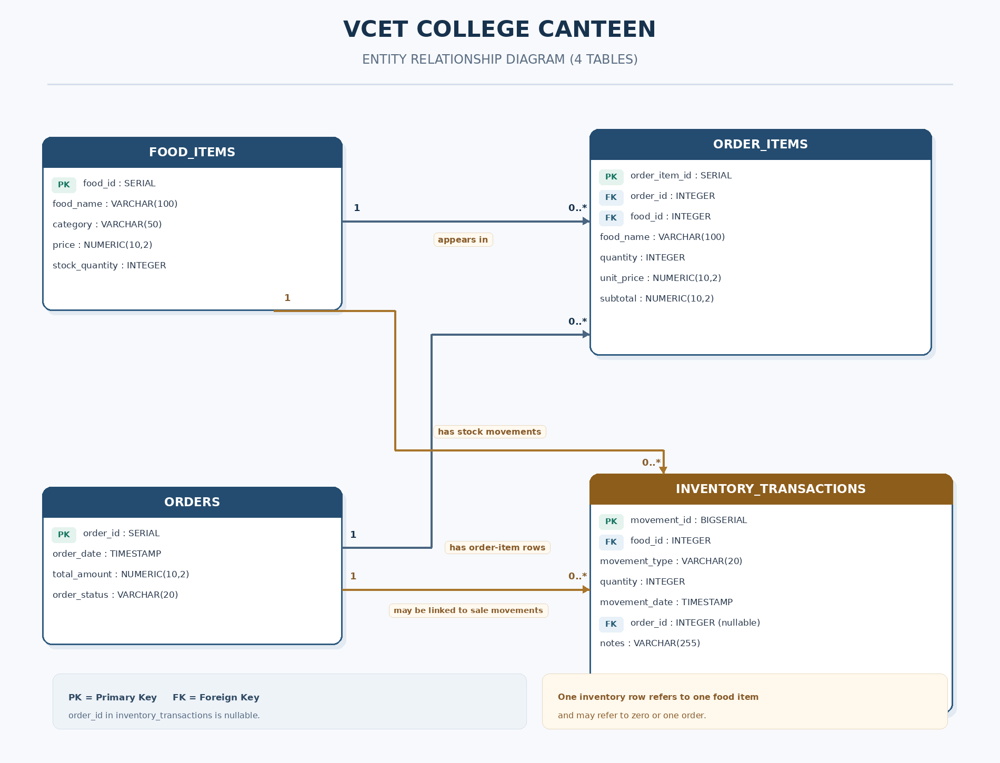
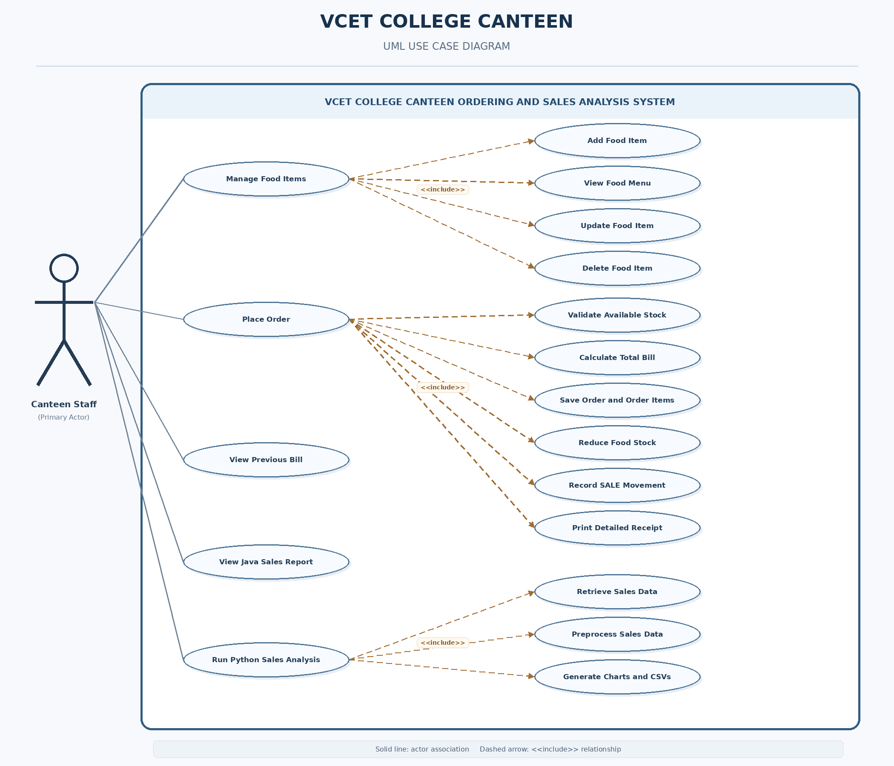
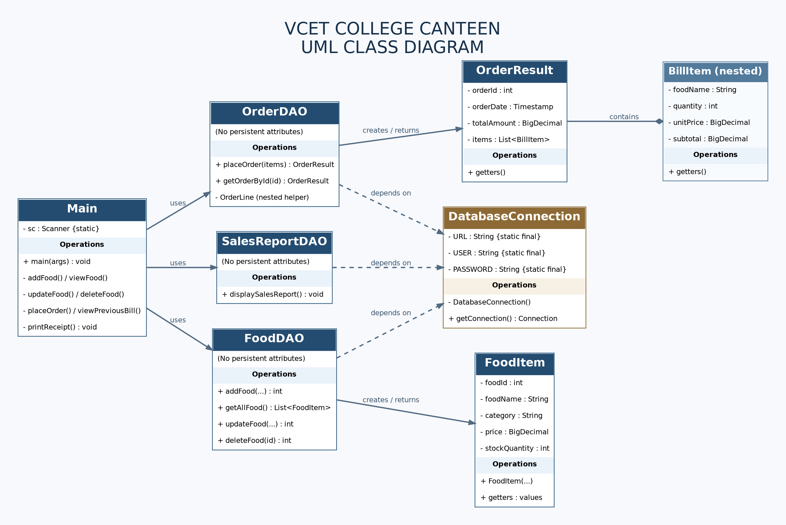
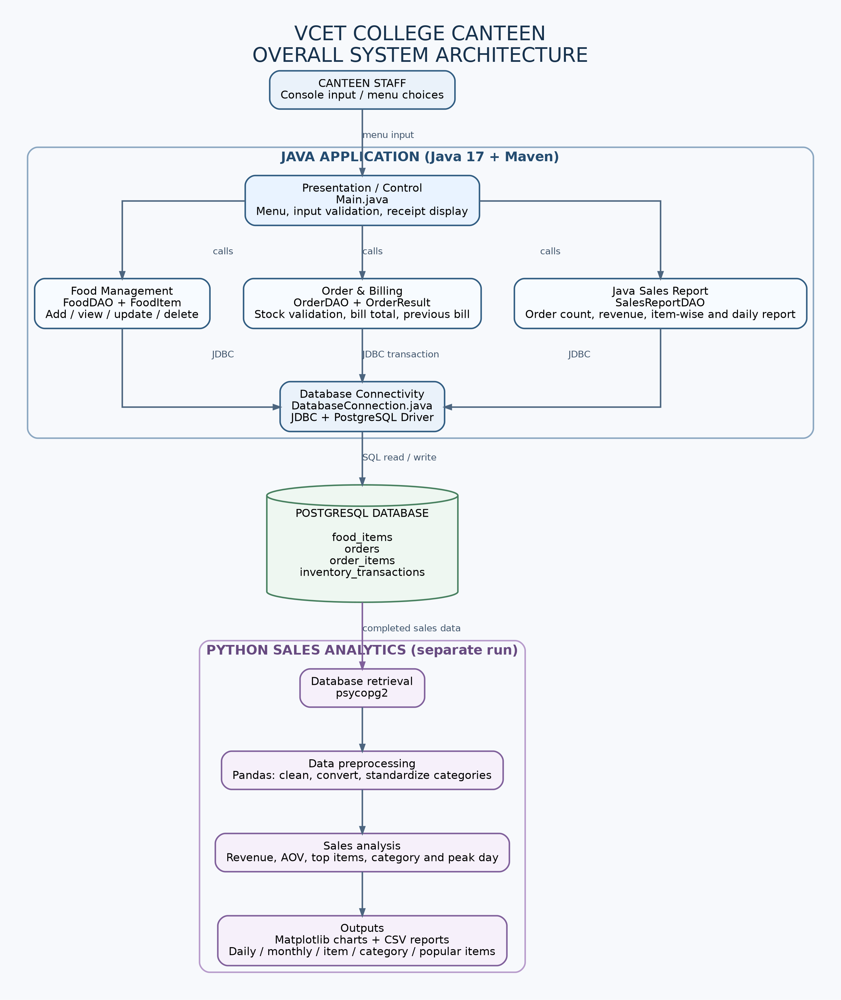
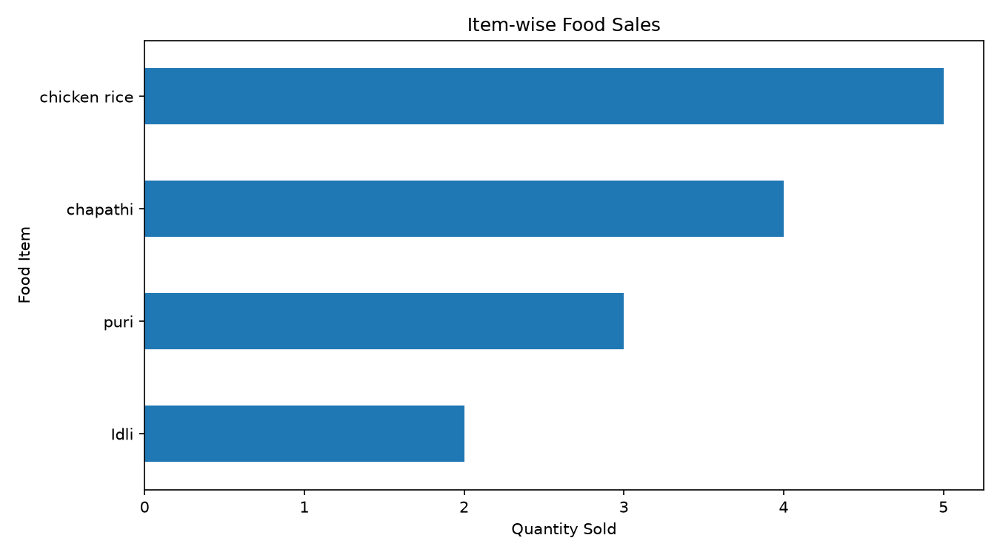
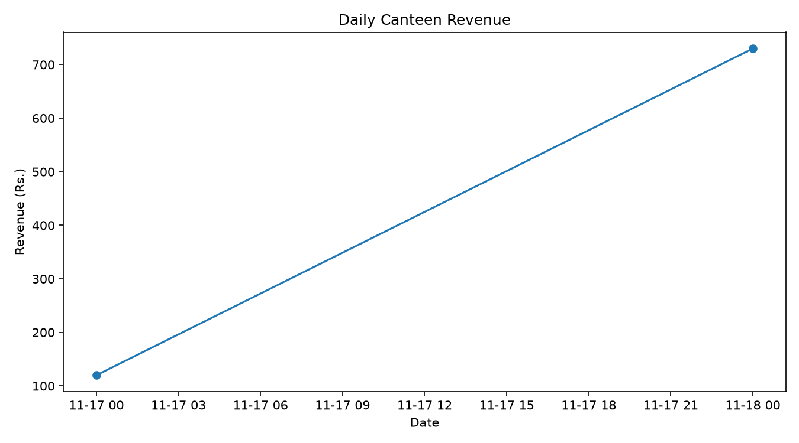
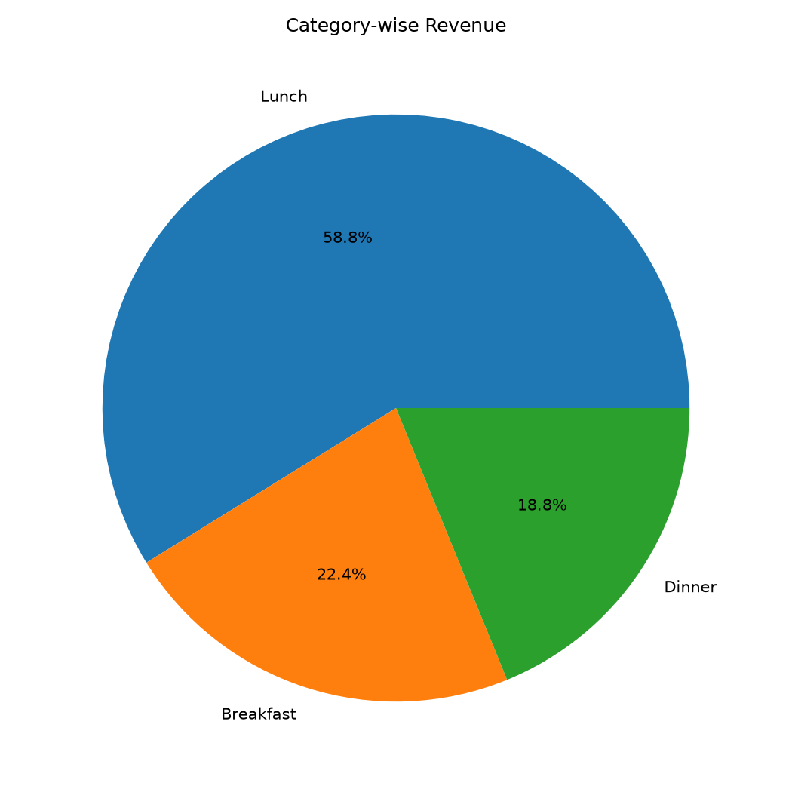
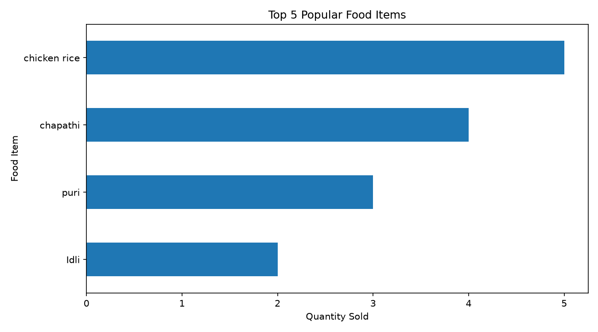
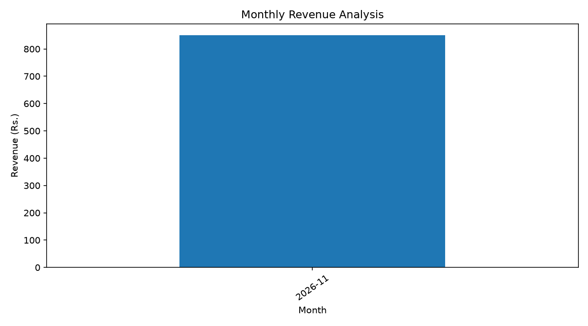

# VCET College Canteen Management System

A console-based College Canteen Ordering and Sales Analysis System developed for the Department of Information Technology at Velalar College of Engineering and Technology (VCET).

The project uses **Java 17, Maven, JDBC and PostgreSQL** for canteen operations, and **Python, Pandas and Matplotlib** for sales analysis and visualization.

---

## 1. Project Overview

The system helps a canteen operator manage food items, process multi-item orders, generate customer bills, maintain stock quantities, retrieve previous bills and review sales information.

A separate Python program connects to the same PostgreSQL database, retrieves completed sales records, processes the data and generates summary reports, CSV files and charts.

### Project Objectives

- Maintain food item names, categories, prices and stock quantities.
- Add, view, update and delete food items.
- Accept orders containing multiple food items.
- Validate food IDs and available stock before completing an order.
- Calculate item subtotals and the total bill.
- Save order and order-item details in PostgreSQL.
- Reduce stock after a successful order.
- Record sales-related inventory movements.
- Retrieve a previous bill using its Order ID.
- Generate Java sales reports.
- Analyse sales data and generate visualizations using Python.

---

## 2. Technologies Used

| Technology | Purpose |
|---|---|
| Java 17 | Console application development |
| Apache Maven | Build and dependency management |
| JDBC | Java database connectivity |
| PostgreSQL | Relational database management |
| Python 3 | Sales data analysis |
| Pandas | Data processing and analysis |
| Matplotlib | Charts and data visualization |
| psycopg2-binary | Python-PostgreSQL connectivity |
| python-dotenv | Loading Python environment variables |
| Git and GitHub | Version control and project hosting |

---

## 3. Main Modules

### 3.1 Food Item Management

- Add a food item with its name, category, price and initial stock.
- View all food items.
- Update food item details.
- Delete a food item when database foreign-key constraints allow it.

### 3.2 Order Processing

- Display the food menu before order entry.
- Accept one or more food IDs and quantities.
- Validate food IDs and positive quantities.
- Check available stock before accepting an order.
- Reject orders when the requested quantity is unavailable.
- Process order operations within a database transaction.

### 3.3 Billing

- Calculate each item's subtotal using quantity and unit price.
- Calculate the total order amount.
- Display a detailed customer receipt.
- Store order details for later retrieval.

### 3.4 Inventory Management

- Maintain the current stock quantity of each food item.
- Reduce stock after a successful order.
- Record `SALE` inventory movements.
- Support `RESTOCK` and `ADJUSTMENT` movement types in the database design.

### 3.5 Previous Bill

- Retrieve a completed bill using its Order ID.
- Display the saved food name, quantity, unit price, subtotal and total amount.

### 3.6 Java Sales Report

The Java sales report displays:

- Total completed orders.
- Total revenue.
- Total quantity of food sold.
- Item-wise quantity and revenue.
- Daily revenue.

### 3.7 Python Sales Analysis

The Python program retrieves completed order and order-item data from PostgreSQL and performs data preprocessing and analysis.

It generates:

- Total revenue.
- Total number of orders.
- Total quantity sold.
- Average order value.
- Item-wise sales.
- Top five popular food items.
- Best-selling food item.
- Category-wise revenue.
- Daily revenue.
- Monthly revenue.
- Peak sales day.

It also saves chart images and CSV reports in `FDS/outputs/`.

---

## 4. Project Architecture

```text
                    CANTEEN OPERATOR
                           |
                           v
                  JAVA CONSOLE MENU
                           |
             +-------------+-------------+
             |             |             |
             v             v             v
        FOOD MODULE    ORDER MODULE   SALES REPORT
             |             |
             |             v
             |       BILLING AND STOCK
             |             |
             +-------------+
                           |
                           v
                    JDBC CONNECTION
                           |
                           v
                      POSTGRESQL
                           |
                           v
                  COMPLETED SALES DATA
                           |
                           v
                   PYTHON DATA ANALYSIS
                           |
                 +---------+---------+
                 |                   |
                 v                   v
            CSV REPORTS        CHART IMAGES
```

The Java application handles canteen operations. PostgreSQL stores operational data. The separate Python program reads completed sales data and generates analytical outputs.

---

## 5. Project Folder Structure

```text
VCET-College-Canteen/
│
├── DBMS/
│   ├── ER_Diagram.png
│   ├── migrate_existing_database.sql
│   ├── queries.sql
│   ├── Relationalmodel_normalization.md
│   └── schema.sql
│
├── documents/
│   └── PROJECT_SCOPE.md
│
├── FDS/
│   ├── requirements.txt
│   ├── sales_analysis.py
│   └── outputs/
│       ├── category_wise_revenue.png
│       ├── daily_revenue.png
│       ├── item_sales_report.csv
│       ├── item_wise_sales.png
│       ├── monthly_revenue.png
│       ├── orders_report.csv
│       └── popular_food_items.png
│
├── Software/
│   ├── Class_Diagram.dot
│   ├── Class_Diagram.png
│   ├── SRS_Document.md
│   ├── System_Architecture_Diagram.dot
│   ├── System_Architecture_Diagram.png
│   ├── TestCases.md
│   └── Use_Case_Diagram.png
│
├── src/
│   └── main/
│       └── java/
│           └── edu/
│               └── vcet/
│                   └── canteen/
│                       ├── DatabaseConnection.java
│                       ├── FoodDAO.java
│                       ├── FoodItem.java
│                       ├── Main.java
│                       ├── OrderDAO.java
│                       ├── OrderResult.java
│                       ├── SalesReportDAO.java
│                       └── sample_input_output.md
│
├── .env.example
├── .gitignore
├── pom.xml
└── README.md
```

---

## 6. Database Design

**Database name:** `canteen_db`  
**DBMS:** PostgreSQL

The database contains four main tables.

| Table | Purpose |
|---|---|
| `food_items` | Stores food names, categories, prices and current stock |
| `orders` | Stores order dates, total amounts and order status |
| `order_items` | Stores the individual food items included in each order |
| `inventory_transactions` | Records sales, restocking and stock adjustments |

### Table Relationships

- One food item can appear in multiple order-item records.
- One order can contain multiple order-item records.
- One food item can have multiple inventory transactions.
- An inventory transaction can refer to an order; the order reference is nullable for non-order stock movements.
- A `SALE` inventory transaction must refer to an order.

The `order_items` table stores the food name and unit price at the time of purchase. These transaction snapshots help preserve historical bill details when current menu information changes.

### Entity Relationship Diagram



### Relational Model and Normalization

Refer to:

`DBMS/Relationalmodel_normalization.md`

### SQL Files

| File | Description |
|---|---|
| `DBMS/schema.sql` | Creates the database tables and indexes |
| `DBMS/queries.sql` | Contains SQL queries for menu, orders, sales and inventory reports |
| `DBMS/migrate_existing_database.sql` | Updates an existing database structure |

**Database setup note:** Run `schema.sql` when creating a new, empty project database. For an existing database, take a backup and use the migration script only when the required changes are not already present. Do not repeatedly run the schema creation script as a substitute for migration.

---

## 7. Software Engineering Documentation

The project includes the following Software Engineering documents and diagrams.

### 7.1 Software Requirements Specification

File: `Software/SRS_Document.md`

Describes the system purpose, problem statement, objectives, scope, user requirements, functional requirements, non-functional requirements, assumptions and error handling.

### 7.2 Use Case Diagram



### 7.3 Class Diagram



Editable diagram source: `Software/Class_Diagram.dot`

### 7.4 System Architecture Diagram



Editable diagram source: `Software/System_Architecture_Diagram.dot`

### 7.5 Test Cases

File: `Software/TestCases.md`

Contains test cases, expected results, actual evidence and test status. Some cases are marked pending or partially evidenced where a separate execution result was not available.

### 7.6 Project Scope

File: `documents/PROJECT_SCOPE.md`

Describes the project objective, included modules, technologies, excluded features and expected outcome.

### 7.7 Java Sample Inputs and Outputs

File: `src/main/java/edu/vcet/canteen/sample_input_output.md`

Contains representative console inputs and outputs. The document distinguishes observed results from examples that still require a fresh capture.

---

## 8. Python Data Analysis and Visualization

The Python component is located in the `FDS/` folder.

### Python Libraries

The dependencies are listed in `FDS/requirements.txt`:

- pandas
- matplotlib
- psycopg2-binary
- python-dotenv

### Generated Charts

#### Item-wise Food Sales



#### Daily Revenue



#### Category-wise Revenue



#### Top Five Popular Food Items



#### Monthly Revenue



### Generated CSV Reports

- `FDS/outputs/item_sales_report.csv`
- `FDS/outputs/orders_report.csv`

The charts and CSV files are generated by running the Python analysis script against the configured PostgreSQL database.

---

## 9. Installation and Execution

### 9.1 Prerequisites

Install the following software:

1. Java Development Kit (JDK) 17
2. Apache Maven
3. PostgreSQL
4. Python 3
5. Git
6. VS Code or IntelliJ IDEA

### 9.2 Clone the Repository

```powershell
git clone https://github.com/virudhiga07/College-Canteen-System.git
cd College-Canteen-System
```

If the repository folder has a different name, open the folder that contains `pom.xml`.

### 9.3 Create the PostgreSQL Database

Open pgAdmin or PostgreSQL terminal and create the database:

```sql
CREATE DATABASE canteen_db;
```

Connect to `canteen_db` and execute:

`DBMS/schema.sql`

This creates the required tables and indexes.

If you are using an already populated database, back it up first and check whether the migration is needed before executing:

`DBMS/migrate_existing_database.sql`

### 9.4 Configure Java Database Connection

The Java application reads these environment variables:

- `DB_URL` — defaults to `jdbc:postgresql://localhost:5432/canteen_db`
- `DB_USER` — defaults to `postgres`
- `DB_PASSWORD` — required

In Windows PowerShell, set the values for the current terminal session:

```powershell
$env:DB_URL="jdbc:postgresql://localhost:5432/canteen_db"
$env:DB_USER="postgres"
$env:DB_PASSWORD="YOUR_POSTGRES_PASSWORD"
```

Replace the placeholder with your own local PostgreSQL password. Do not commit the real password to GitHub.

### 9.5 Compile the Java Application

From the project root folder containing `pom.xml`, run:

```powershell
mvn clean compile
```

### 9.6 Run the Java Application

The Maven `exec` plugin is configured with the main class `edu.vcet.canteen.Main`.

Run:

```powershell
mvn exec:java
```

The console menu provides these options:

```text
1. Add Food Item
2. View Food Items
3. Update Food Item
4. Delete Food Item
5. Place Order
6. Sales Report
7. View Previous Bill
0. Exit
```

### 9.7 Install Python Dependencies

From the project root:

```powershell
py -m pip install -r FDS/requirements.txt
```

### 9.8 Configure Python Database Connection

The Python script loads environment variables from:

`FDS/.env`

Create this local file and add your PostgreSQL settings:

```env
PGHOST=localhost
PGPORT=5432
PGDATABASE=canteen_db
PGUSER=postgres
PGPASSWORD=YOUR_POSTGRES_PASSWORD
```

Replace the password placeholder with your local PostgreSQL password.

**Do not upload `FDS/.env` to GitHub.** Keep it local and private.

### 9.9 Run Python Sales Analysis

From the project root folder:

```powershell
py FDS/sales_analysis.py
```

The script retrieves completed sales records from PostgreSQL, performs analysis and saves the generated charts and CSV reports in:

`FDS/outputs/`

---

## 10. Sample Sales Analysis Result

The following is a sample result recorded during project testing. The figures depend on the data stored in the database.

```text
VCET COLLEGE CANTEEN SALES ANALYSIS

--- OVERALL SALES SUMMARY ---
Total Revenue       : Rs. 850.00
Total Orders        : 5
Total Quantity Sold : 14
Average Order Value : Rs. 170.00

Best-Selling Food Item: chicken rice

--- CATEGORY-WISE REVENUE ---
Lunch        500.0
Breakfast    190.0
Dinner       160.0

--- MONTHLY REVENUE ---
2026-11    850.0

--- PEAK SALES DAY ---
Date: 2026-11-18
Revenue: Rs. 730.00
```

These are sample test-dataset figures, not live canteen sales.

---

## 11. Testing and Validation

The project test cases are documented in `Software/TestCases.md`.

Testing covers:

- Java database connection.
- Adding and viewing food items.
- Updating and deleting food items.
- Multi-item order processing.
- Bill calculation and receipt generation.
- Insufficient-stock rejection.
- Stock reduction after a successful order.
- Previous bill retrieval.
- Java sales reporting.
- Python sales data retrieval and analysis.
- Chart and CSV generation.
- Inventory transaction recording.

### Build Verification

The Java project was compiled successfully during development using:

```powershell
mvn clean compile
```

The recorded Maven result was:

```text
BUILD SUCCESS
```

Refer to `Software/TestCases.md` for the individual test statuses and evidence. Pending test cases should not be considered passed until they have been executed and recorded.

---

## 12. Current Project Scope and Limitations

The current implementation is a **single-user, console-based academic prototype**.

The following are outside the current project scope:

- Customer account registration and login.
- Staff roles and role-based access.
- Online payment gateway.
- Food delivery tracking.
- Mobile application.
- Web-based frontend.
- Multi-user concurrent workflows.

These may be considered as future enhancements.

---

## 13. Future Enhancements

- Develop a web-based user interface.
- Add secure user authentication and staff roles.
- Integrate digital payment options.
- Add a dashboard for sales and inventory.
- Introduce low-stock notifications.
- Add advanced sales forecasting and demand analysis.

---

## 14. Project Information

**Project Name:** VCET College Canteen Management System  
**Institution:** Velalar College of Engineering and Technology  
**Department:** Information Technology  
**Application Type:** Java Console-Based Application  
**Database:** PostgreSQL  
**Analytics:** Python Data Analysis  

**GitHub Repository:**  
https://github.com/virudhiga07/College-Canteen-System-Project

---
